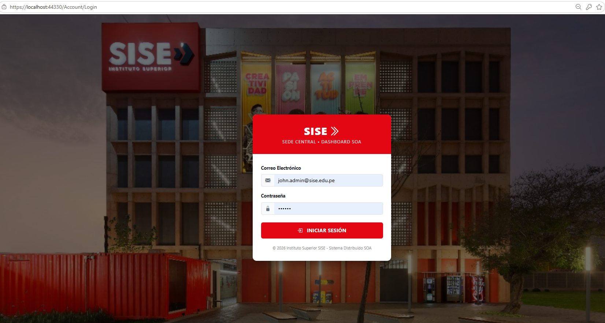
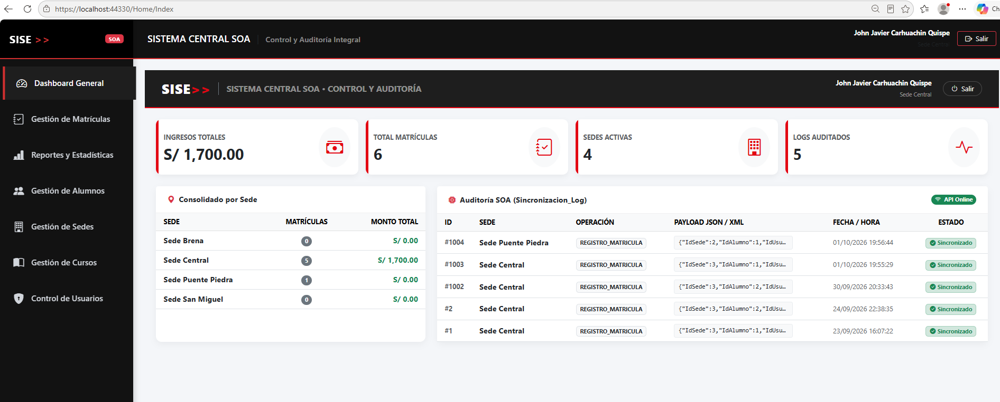
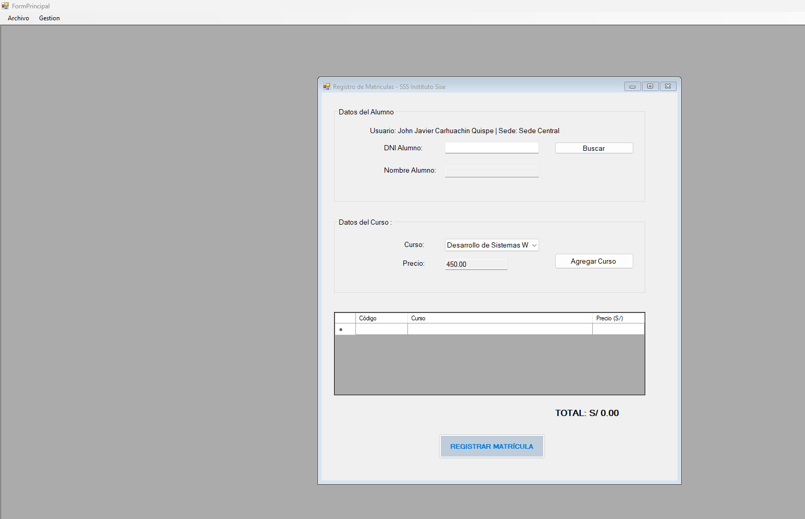
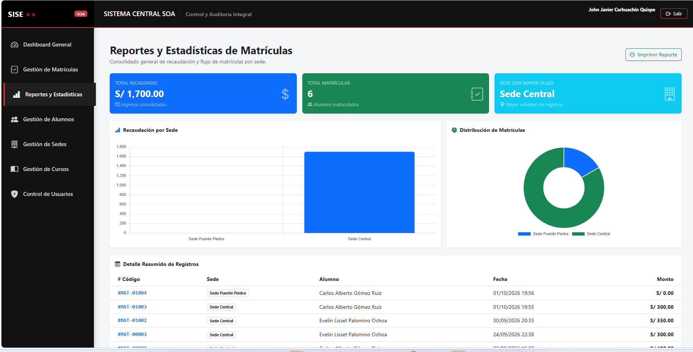

# 🗄️ Sistema Central SOA con WCF y C#

---

## 📝 Descripción del Proyecto

**Sistema Central SOA** es una solución empresarial desarrollada en el entorno de .NET basada en una **Arquitectura Orientada a Servicios (SOA)**. Su propósito principal es gestionar la sincronización e integración de datos distribuidos entre diferentes sedes o subsistemas corporativos, garantizando la trazabilidad, alta disponibilidad y consistencia de la información operacional.

---

## ⚙️ Funcionalidades Clave

- 🔄 **Sincronización de Datos Distribuidos:** Transferencia y consumo de servicios WCF para la integración de bases de datos heterogéneas.
- 📜 **Trazabilidad y Control de Logs:** Registro centralizado de transacciones y auditoría en formatos XML y JSON.
- 🛡️ **Manejo de Excepciones y FaultContracts:** Gestión estructurada de fallos en llamadas SOAP / WCF.
- 💻 **Interfaz de Administración:** Cliente de gestión escritorio en Windows Forms para el monitoreo de endpoints.

---

## 🏗️ Arquitectura del Sistema

El proyecto implementa los principios fundamentales de SOA:

- **Service Contracts (`[ServiceContract]`):** Definición de interfaces de comunicación desacopladas.
- **Data Contracts (`[DataContract]`):** Estructuras de datos serializables para intercambio ligero.
- **Service Layer:** Lógica de negocio en C# consumiendo procedimientos almacenados en SQL Server.
- **Persistence Layer:** Microsoft SQL Server con transacciones ACID.

---
---

## 📸 Capturas del Sistema

  <b>🔑 Autenticación / Login</b> 
  

 

  <b>📊 Dashboard Principal</b> 
  

 

  <b>📝 Gestión de Matrícula</b> 
  

 

  <b>📈 Módulo de Reportes</b> 
  

---

## 🚀 Requisitos para Ejecución

- Visual Studio 2022 o superior con soporte para **WCF Services**.
- .NET Framework 4.8 o .NET Core con WCF Client libraries.
- Microsoft SQL Server Manager Studio (SSMS).

---

## 📬 Autor
* **John Javier Carhuachin Quispe**
* LinkedIn: [Perfil Profesional](https://www.linkedin.com/in/john-javier-32a068446/)
* Email: johncarhuaching@gmail.com
